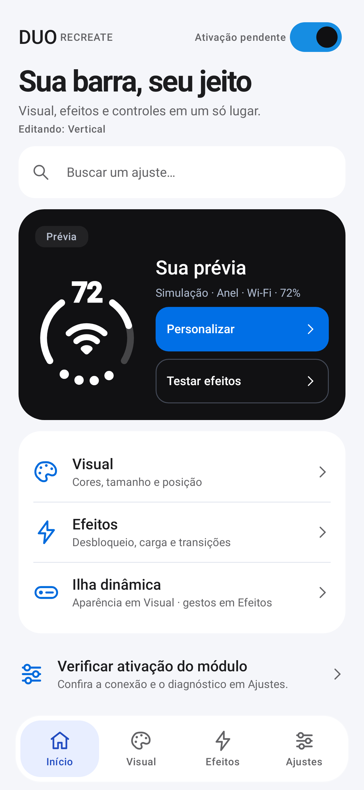
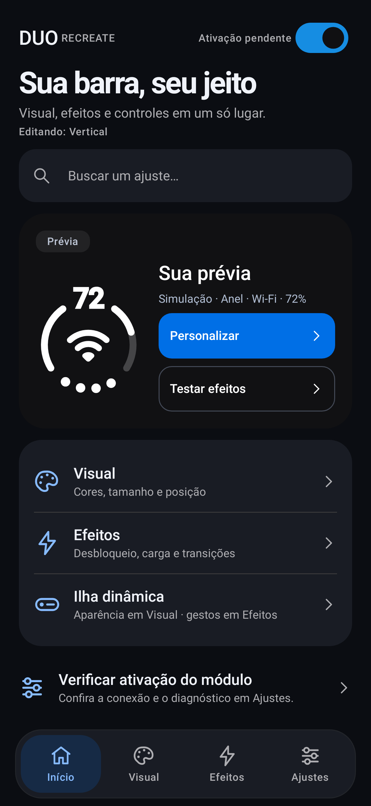
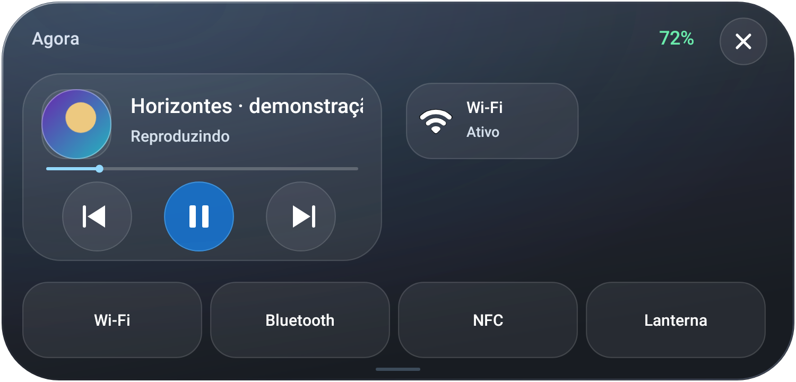

# DUO Recreate

### Your bar, your way.

Battery, music and device status in a customizable ring, with a dynamic island for quick controls.

  

**[Download APK](https://github.com/edugrepo1-jpg/duoStatusBar/releases/latest)** · [Installation](INSTALL.en.md)

[Português](../README.md) · [English](README.en.md) · [Español](README.es.md)

## Interface

 

Images show the app with demonstration data.

## Features

- Customize colors, size, position and icons.
- Follow music with circular artwork, effects and playback controls.
- Preview and adjust animations, unlock effects and transitions.
- Find everything in Home, Visual, Effects and Settings.

Interface · Dynamic Island

## Installation

**Android 13+ · root required · Portuguese, English and Spanish**

1. Install the APK and choose your language.
2. In LSPosed, enable DUO Recreate for System UI and reboot. To try without LSPosed, open Settings → Advanced → Root without LSPosed and authorize it in your root manager.
3. Enable the bar at the top of Home. Customize in Visual and try effects in the preview.

LSPosed mode available; standalone root mode is experimental. Icon hiding and panel support vary by ROM.

---

Inspired by [Duo Status Bar](https://github.com/kvmy666/duoStatusBar), de **kvmy666**. [GPL-3.0](../LICENSE).
